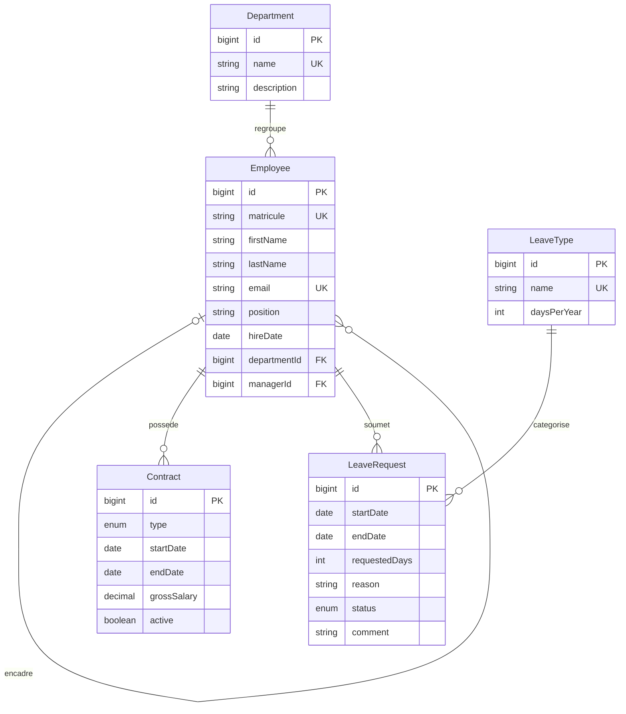

# AtlasRH API REST

API de gestion RH en Java 17, Spring Boot, Spring Data JPA, PostgreSQL, Liquibase et MapStruct.

## Lancement

```bash
docker compose up -d
./mvnw spring-boot:run
```

PostgreSQL écoute sur `localhost:5434` (base `atlasrh_db`, identifiants de développement définis dans `compose.yml`). Liquibase crée les tables et initialise les types de congé. L’API écoute sur `http://localhost:8081`. Swagger UI : `/swagger-ui.html`; spécification : `/v3/api-docs`.

Au prochain démarrage, Liquibase ajoute des données de démonstration pour tester les API : employés `AT-0001` (manager), `AT-0002` et `AT-0003`, leurs contrats, ainsi que des demandes de congé approuvée, en attente et refusée. Les types de congé sont `ANNUEL` (ID 1) et `EXCEPTIONNEL` (ID 2) sur une base neuve. Nadia (`AT-0001`) gère Youssef (`AT-0002`) et Salma (`AT-0003`).

## Architecture

- `controller`: HTTP et validation de forme; jamais de logique métier.
- `service`: règles métiers et transactions; les controllers ne renvoient que des DTO.
- `repository`: accès JPA.
- `entity`: modèle persistant.
- `dto` et `mapper`: contrats JSON et conversion MapStruct.
- `exception`: erreurs HTTP centralisées (400, 404, 409).

## Endpoints principaux

| Domaine | Routes |
|---|---|
| Départements | `POST/GET /api/departments`, `GET/PUT/DELETE /api/departments/{id}` |
| Employés | `POST/GET /api/employees`, `GET/PUT /api/employees/{id}`, `GET /api/employees/{id}/team` |
| Contrats | `POST /api/contracts`, `POST /api/contracts/{id}/end`, `GET /api/contracts/employee/{employeeId}` |
| Congés | `POST /api/leave-requests`, `GET /api/employees/{id}/leave-requests?status=EN_ATTENTE`, `POST /api/employees/{id}/leave-requests/{requestId}/cancel` |
| Manager | `GET /api/managers/{id}/leave-requests/pending`, `POST /api/managers/{id}/leave-requests/{requestId}/decision` |
| Solde | `GET /api/employees/{id}/leave-balance`, `GET /api/employees/{id}/seniority` |

Exemple de création employé :

```json
{"matricule":"AT-001","firstName":"Salma","lastName":"Amrani","email":"salma@example.test","position":"Analyste RH","hireDate":"2024-02-01","departmentId":1,"managerId":null}
```

Exemple de décision manager : `{"approved":false,"comment":"Période non couverte"}`. Les requêtes sont en JSON. Aucune authentification n’est activée : les identifiants employés/managers sont donc passés dans les routes conformément au périmètre V1.

Les demandes calculent les jours ouvrés du lundi au vendredi, dates comprises. Les soldes sont calculés à partir des congés approuvés de l’année civile. L’annulation est réservée au propriétaire et aux demandes en attente; une décision négative exige un commentaire.

## Diagramme métier



## Planification Jira proposée

- **Epic RH**: US départements, employés, contrats. Critères: unicité nom/matricule/e-mail, département non supprimable s’il est occupé, manager différent du salarié, un contrat actif maximum.
- **Epic Congés**: US demande, décision, consultation du solde. Critères: jours ouvrés, pas de chevauchement, demande au statut attendu, solde suffisant, refus commenté, annulation propriétaire seulement.
- **Tâches transverses**: modèle Liquibase et données de référence, DTO/MapStruct, gestion des erreurs, OpenAPI, README/diagramme, démonstration.

## Stratégie de tests et qualité (Sprint 3)

- Tests unitaires JUnit 5 / Mockito des services : unicité matricule/e-mail, manager de soi-même, contrat actif unique, jours ouvrés, solde, décision et annulation.
- Tests MVC avec `@WebMvcTest` et `MockMvc` : création, validation, réponses JSON, pagination et conflits HTTP.
- Tests repository avec `@DataJpaTest` : recherche, filtre département, pagination et tri.
- Tests de bout en bout avec `@SpringBootTest` et MockMvc : approbation d’une demande et refus de suppression d’un département occupé.
- Les tests Spring utilisent le profil `test`, H2 en mémoire et Liquibase. Ils ne se connectent pas à PostgreSQL de développement.

### Exécuter les tests et produire le rapport

```bash
mvn test
mvn verify
```

Le rapport HTML JaCoCo est généré dans `target/site/jacoco/index.html`. Le contrôle Maven impose une couverture des lignes du bundle de 80 % au moment de `verify`; le build échoue tant que ce seuil n’est pas atteint. Le rapport de sprint est dans [`docs/quality-report.md`](docs/quality-report.md), et les user stories et critères d’acceptation prêts à saisir dans Jira dans [`docs/jira-plan.md`](docs/jira-plan.md).

### Analyse SonarQube locale

Après démarrage d’une instance SonarQube et création d’un token local :

```bash
mvn verify sonar:sonar -Dsonar.host.url=http://localhost:9000 -Dsonar.token="$SONAR_TOKEN" -Dsonar.projectKey=atlasrh
```

Le projet doit être analysé dans SonarQube pour renseigner les observations et le statut Quality Gate dans le rapport. Aucun résultat Sonar n’est déclaré avant cette exécution.
